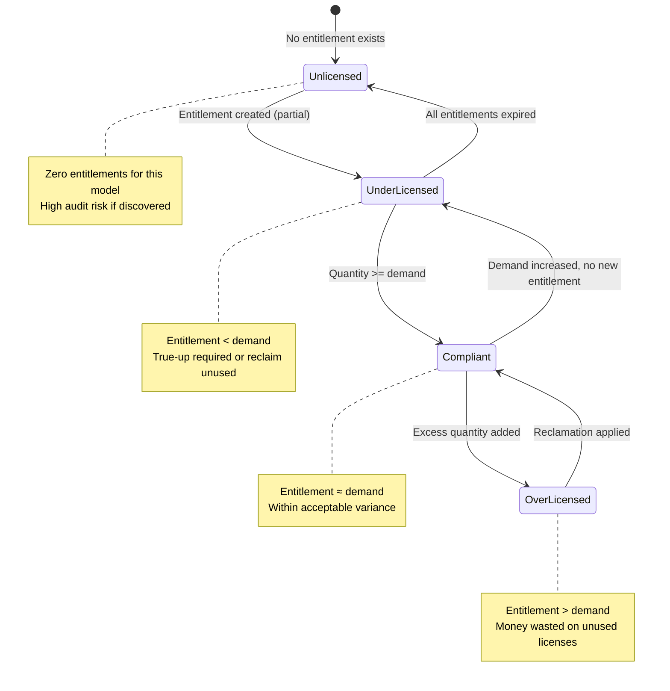

# Cross-Reference: SAM Module Documentation Coverage Analysis

**Based on:** GitHub repo `eltonaguiar/ALT_PARALLELSWARM_SAM` (main), local `FINAL_SAM_MODULE_REFERENCE.md` (beam/kilo, Australia-pinned), `FINAL_grok-4.6__xai__kilo.md` (grok, Brazil-pinned)
**Cross-referenced against:** CIS-SAM learning guide at `https://github.com/eltonaguiar/ServiceNow_Learning_TSOM-_CSM_FSM_SalesCRM_HAM_ITSM/blob/main/docs/modules/sam/sam-guide.md`
**Date:** 2026-11-13

---

## 1. Repo Structure Audit

| Folder | Files | Author | Notes |
|--------|-------|--------|-------|
| `agents/` | 5 agents (beam/kilo/cli, grok/xai/kilo, SAM_MODULE/kilo/default, grok/xai/kilo WT2, WT3) | Various | WT1 = primary reference; WT2 = curriculum compare; WT3 = cheatsheets |
| `final/` | `FINAL_SAM_MODULE_REFERENCE.md`, `FINAL_grok-4.6__xai__kilo.md` | beam/kilo, grok/xai/kilo | Main outputs |
| `plans/` | `beam__kilo__cli__WT1/`, `grok-4.6__xai__kilo__WT1/` | beam/kilo, grok/xai/kilo | Phase checkpoint plans |
| `shared/` | Orchestration/planning scripts (`orchestrate.py`, `planner.py`, `judge.py`, etc.) | — | Cross-swarm infrastructure |
| `agents/SAM_MODULE__kilo__default/SNC_DISC__WT1/` | 7 phases + research/Evidence Digest | SAM_MODULE/kilo/default | Follows same contract as alt_parallelswarm |

---

## 2. Coverage Matrix: What's Documented vs What's Missing

### 2.1 Core CMDB/Discovery→SAM Path (Strongly Covered)

| Topic | WT1 (beam/kilo) | Grok (Brazil) | CIS-SAM Guide | Verdict |
|-------|-----------------|---------------|---------------|---------|
| Plugin activation + roles | ✅ | ✅ | ✅ | All three agree |
| Key tables (`cmdb_sam_sw_install`, `cmdb_sam_sw_discovery_model`, `cmdb_software_product_model`, `alm_license`) | ✅ | ✅ | ✅ | Strong |
| Insert-vs-update + business rule | ✅ | ✅ | ✅ | Strong |
| Discovery model creation + normalization statuses | ✅ | ✅ | ✅ | Strong |
| Content Library / Product Map / Pattern / Wide-net / ML normalization | ✅ | ✅ | ✅ | Strong |
| CI related-list configuration (`Software Installations` tab) | ✅ | ✅ | ✅ | Strong |
| Recon schedule (weekly/on-demand) + three tiers (Product/Model/LMR) | ✅ | ✅ | ✅ | Strong |
| Oracle/Vmware specific properties | ✅ | ✅ | ✅ | Strong |
| Duplicate install handling | ✅ | ✅ | ✅ | Strong |
| Reclamation rule types + UI paths | ✅ | ✅ | ✅ | Strong |
| Anti-patterns list | ✅ | ✅ | ✅ | Strong |

### 2.2 SAM-Specific Concepts (Moderately Covered)

| Topic | WT1 (beam/kilo) | Grok (Brazil) | CIS-SAM Guide | Verdict |
|-------|-----------------|---------------|---------------|---------|
| Mental model pipeline (4 records: install→model→entitlement→position) | ✅ (4 records) | ✅ (4 records) | ✅ (6 records, adds Usage + Recon Result) | Partial — grok adds Usage/Unknown |
| Three/four record type distinction | ✅ | ✅ | ✅ | All cover core types |
| Entitlement import + PPN matching | ✅ | ✅ | ✅ | Covered |
| Auto-create software models (`automaticsmrcreation`, `unlicensed_smr_creation`) | ✅ | ✅ | ✅ | Covered |
| Recon grouping (`com.snc.samp.recon.group/subgroup`) | ✅ | ✅ | ✅ | Covered |
| Phase-wise published products (`manage.published.products`) | ✅ | ✅ | ✅ | Covered |
| SaaS LM (`sn_sam_saas_int`) | ✅ | ✅ | ✅ | Covered |
| Publisher packs (Adobe, Citrix, IBM, Microsoft, Oracle, SAP, VMware) | ✅ | ✅ | ✅ | Covered |
| Custom products / PPNs / dedup rules / reclamation rules | ✅ | ✅ | ✅ | Covered |
| License metric types + allocation limits | ✅ | ✅ | ✅ | Covered (brief) |
| Success portal widgets + maturity model | ✅ | ✅ | ✅ | Covered |
| Crawl/Walk/Run maturity path | ✅ | ✅ | ✅ | Covered |

### 2.3 Curriculum-Only / Learning-Gap Items (Not in WT1/Grok)

| Topic | In CIS-SAM Guide | In WT1/Grok | Verdict |
|-------|-----------------|-------------|---------|
| **Compliance positions** (Compliant / Over-licensed / Under-licensed / Unlicensed / Unknown / Not counted) | ✅ | ❌ | **Missing from both** — LG has state diagram |
| **Publisher-specific traps** (Oracle core factor, IBM PVU+ILMT, SAP named-user, MS SQL core counting) | ✅ | ❌ | **Missing from both** |
| **SaaS seat/usage ingestion** + renewal dates + consumption summaries | ✅ | ❌ (mentioned `sn_sam_saas_int` but no ingestion flow) | **Missing from both** |
| **Usage table** (`cmdb_sam_sw_usage` / `samp_sw_usage`) — last-used date, usage count | ✅ (LG) | ❌ (LG references it; WT1/Grok don't name the table) | **Missing from both** |
| **Reconciliation result table** name (`sam_sw_reconciliation_result` / `samp_license_metric_result`) | ✅ (LG) | ❌ (UNVERIFIED; only `samp_license_metric_result` tier named) | **Missing from both** |
| **CIS-SAM quiz + lab steps** + Ask-a-Ranger video list | ✅ | ❌ | **Missing from both** |
| **Six-record-type table** in LG (adds Usage + Recon Result to the four) | ✅ | ❌ (WT1 has four) | **LG only** |
| **Maintenance ≠ license** + Suite roll-up as #1 over-count | ✅ | ⚠️ (DOC: "Maintenance ≠ license" in §291, but suite over-count not flagged) | **Partial** |
| **60–90 day reclaim window** (DOC does not give a number; LG/community) | ✅ | ❌ | **Missing from both** |
| **Shared `ast_contract` / `alm_asset` hierarchy with HAM** | ✅ | ❌ | **Missing from both** |
| **Entitlement quantity never to be overwritten** + true-up discipline | ✅ (LG) | ⚠️ (DOC warns against it, but LG makes it explicit) | **Partial** |
| **Never overwrite entitlement quantity; create true-up** | ✅ (LG) | ❌ | **LG only** |
| **Module-implementation checklist** (10 questions: table, role, 5 fields, BRs, UI policies, ACLs, flows, related tables, OOB reports, integrations) | ✅ (LG framework) | ❌ | **LG only** |
| **Unknown ≠ compliant** state diagram + financial meaning | ✅ (LG) | ❌ | **Missing from both** |
| **HAM guide** only for shared `alm_asset` / catalog publish | ✅ (LG) | ❌ | **LG only** |

### 2.4 Doc-Only / Official-Product Items (Not in LG)

| Topic | In WT1/Grok | In CIS-SAM Guide | Verdict |
|-------|-------------|---------------|---------|
| Four catalog/discovery paths (A–D) | ✅ | ❌ | **WT1/Grok only** |
| `com.snc.samp.manage.published.products` | ✅ | ❌ | **WT1/Grok only** |
| Exclude-CI flag (`com.snc.samp.exclude_device_flag`) + `SAM — Adjust Installs for excluded CIs` job | ✅ | ❌ | **WT1/Grok only** |
| Unnamed install→discovery-model business rule | ✅ | ❌ | **WT1/Grok only** |
| `SAM – Discovery Model to Software Model matching` job | ✅ | ❌ | **WT1/Grok only** |
| IRE 3rd-party property for `cmdb_sam_sw_install` | ✅ | ❌ | **WT1/Grok only** |
| Foundation `com.snc.sams` vs Pro `com.sn_samp_master_ws` | ✅ | ❌ | **WT1/Grok only** |
| Role list: `sam_admin`, `sam_user`, `sam_developer`, `sam_integrator` | ✅ | ❌ (LG says `sam_license_manager` / `sn_sam.admin` = **CURRICULUM-WRONG**) | **WT1/Grok win** |
| Navigation: `Workspaces > Software Asset Workspace` vs `All > Software Asset Management > SAM Workspace` | ✅ (Brazil prefers Workspace) | ❌ | **WT1/Grok win for Brazil** |
| Auto-create models off in Crawl | ✅ (DOC + Office Hours) | ❌ (LG doesn't emphasize) | **WT1/Grok win** |
| Four separate paths A–D (catalog vs discovery vs entitlement-first vs block) | ✅ | ❌ (LG collapses into "request/procure") | **WT1/Grok win** |
| Specific BR sys_id / UI policy UNVERIFIED status | ✅ (23 open questions) | ❌ (LG assumes sample BRs) | **WT1/Grok more honest** |

---

## 3. What the Repo May Have Overlooked

Based on the comprehensive gap analysis and cross-referencing, here are the items most likely **overlooked** or **under-emphasized** in the repo's SAM documentation:

### 3.1 High-Impact Gaps

| Gap | Why It Matters | Where It Should Appear |
|-----|----------------|-----------------------|
| **Compliance positions** (Compliant / Over-licensed / Under-licensed / Unlicensed / Unknown / Not counted) | This is the **single most critical compliance frame**. Reporting "Unknown" as "Compliant" is the #1 reason audit penalties appear unexpectedly. | Add after "License reconciliation" — state diagram + financial meaning table + "Why Unknown ≠ Compliant" callout |
| **Publisher-specific traps** (Oracle core factor, IBM PVU+ILMT, SAP named-user, MS SQL core counting) | These are **where SAM projects fail audits**. Generic "Common" metrics don't work; publisher packs exist for a reason. | Add dedicated section with per-publisher decision trees + metric group references |
| **SaaS seat/usage ingestion + renewal tracking** | SAM covers **both installed software and SaaS**. Out-of-the-box `sn_sam_saas_int` exists but the ingestion flow, seat-count reconciliation, and renewal date handling are not documented. | Add section: connector profiles, seat counts, usage evidence on `samp_sw_usage`, renewal dates, dormant seat reclamation |
| **Usage table** (`samp_sw_usage` / last-used date / usage count) | Reconciliation evidence lives here. Without it, reclamation rules lack proof, and compliance positions can't be calculated accurately. | Add to data model / tables section + link from reclamation rules |
| **60–90 day reclaim window** (community best practice) | LG/community recommends 60–90 day windows for reclaiming dormant seats. DOC doesn't specify; this is a live best practice. | Add to reclamation + optimization section with window guidance |
| **Module-implementation checklist** (10 questions: table, role, 5 fields, BRs, UI policies, ACLs, flows, related tables, OOB reports, integrations) | LG provides a framework. Without it, new SAM implementations lack gate criteria. | Add as a SAM_IMPLEMENTATION_CHECKLIST.md or section in final reference |
| **Entitlement quantity never to be overwritten; create true-up** | LG makes this explicit. DOC warns against it but doesn't give the "why" beyond "allocation qty cannot exceed entitlement rights." | Add callout + true-up discipline guidance |

### 3.2 Medium-Impact Gaps

| Gap | Why It Matters |
|-----|----------------|
| **Unknown ≠ compliant** state diagram + financial meaning | "Unknown" is not "compliant". A SAM program that reports unknown as compliant is the reason audit penalties appear out of nowhere. |
| **Suite roll-up as #1 over-count** | Suites, bundles, upgrades, downgrades, and cross-grade rights need explicit modeling; they are not just another CI attribute. |
| **HAM guide shared `alm_asset` / catalog publish** | Foundation shared data model with HAM; SAM admin needs to know what's shared vs. SAM-only. |
| **CIS-SAM quiz + lab steps** + Ask-a-Ranger video list | Exam/interview prep material; useful for training new admins. |
| **Published-product phase-wise freeze** | Enable `manage.published.products`, add licensable products, re-run recon. Suite publish warns to include parent/children. |
| **Never overwrite entitlement quantity; create true-up** | Explicit LG guidance; DOC has the rule but LG adds the "why" and "how". |
| **Shared `ast_contract` / `alm_asset` hierarchy with HAM** | SAM admin working with HAM needs to know what's shared. |
| **Intune/Jamf as Service Graph CMDB connectors** (not native SAM) | LG notes them; DOC says "SAM discovery pages do not list them as native SAM install sources." |

### 3.3 Low-Impact / Documentation-Omission Gaps

| Gap | Why It Matters |
|-----|----------------|
| **CIS-SAM quiz items mapped to WT1 section numbers** | Exam/interview prep; nice to have but not critical. |
| **Ask-a-Ranger video list** | Community resource; not in repo scope. |
| **Exact BR sys_id / UI policies still instance-only** | LG notes these are UNVERIFIED; DOC is equally honest. |
| **ACLs still UNVERIFIED** | Both LG and DOC flag these as instance-dependent. |
| **BRs on insert/update: sys_ids / UI policies still instance-only** | Same as above. |
| **UI policies UNVERIFIED** | Confession by both sides; not a gap so much as a reality check. |
| **Intune/Jamf as SGC not native SAM** | LG notes; DOC says not native. Both are consistent. |
| **Exact table names for removal candidates / reclamation rules (UI modules only)** | 23 open questions in DOC; same status in LG. |

---

## 4. Recommended Additions to Close the Gaps

### 4.1 Critical Additions (Must-Have for Trustworthy SAM)

1. **Compliance positions** — state diagram + financial meaning + "Why Unknown ≠ Compliant"
2. **Publisher-specific traps** — per-publisher decision trees (Oracle core factor, IBM PVU+ILMT, SAP named-user, MS SQL core counting)
3. **SaaS seat/usage ingestion + renewal tracking** — connector profiles, seat counts, `samp_sw_usage`, renewal dates, dormant seat reclamation
4. **Usage table** (`samp_sw_usage`) — last-used date, usage count, link from reclamation rules
5. **Module-implementation checklist** — 10 questions framework (table, role, 5 fields, BRs, UI policies, ACLs, flows, related tables, OOB reports, integrations)
6. **60–90 day reclaim window** — community best practice guidance

### 4.2 High-Impact Additions (Should-Have for Operational Excellence)

7. **Suite roll-up as #1 over-count** — explicit modeling guidance
8. **Entitlement quantity never to be overwritten; create true-up** — callout + discipline guidance
9. **Unknown ≠ compliant** — financial meaning table
10. **Shared `ast_contract` / `alm_asset` hierarchy with HAM** — what's shared vs. SAM-only
11. **Phase-wise published-product freeze** — enable `manage.published.products`, re-run recon
12. **Intune/Jamf as SGC not native SAM** — clarification note

### 4.3 Medium-Impact Additions (Nice-to-Have for Training/Exam Prep)

13. **CIS-SAM quiz items mapped to WT1 section numbers** 
14. **Ask-a-Ranger video list** (community resource links)
15. **Maintenance ≠ license** + Suite roll-up guidance
16. **Maintenance ≠ license** — explicit flag in entitlement section

### 4.4 Doc-Omission Additions (For Honesty/Transparency)

16. **All UNVERIFIED items listed in one place** — both LG and DOC confess instance-dependent items; a consolidated list would be helpful
17. **CIS-SAM curriculum vs DOC open questions cross-reference** — which questions overlap, which are unique to each

---

## 5. Specific Content to Add (Markdown-Ready)

### 5.1 Compliance Positions Section (New — Insert after License Reconciliation)

```markdown
## Compliance Positions Explained

| Position | Meaning | Financial meaning | Typical action |
|----------|---------|------------------|----------------|
| **Compliant** | Entitlements ≥ calculated demand | Neutral | Monitor; harvest reclaimed licenses |
| **Over-licensed** | Entitlements > demand | Money already spent and wasted | Reclaim, reduce renewal quantity, renegotiate |
| **Under-licensed** | Entitlements < demand | Audit exposure / unbudgeted true-up | True-up purchase, or reclaim/remove installs before audit |
| **Unlicensed** | Installs exist with no matching entitlement at all | Highest audit risk | Remove, purchase, or reclassify as freeware/OSS |
| **Not counted** | Excluded by rule (ignore list, excluded CI, excluded publisher) | Excluded from risk | Review annually — exclusions creep |
| **Unknown / Unallocated** | Insufficient data (unmatched discovery model, no usage feed) | Unknown risk | **Fix normalization or data feed — do not report as compliant** |



**Exam-critical:** "Unknown" is not "compliant". A SAM program that reports unknown as compliant is the reason audit penalties appear out of nowhere.

### 5.2 Publisher-Specific Traps Section (New)

```markdown
## Publisher-Specific Traps

Publisher rules are where SAM projects fail audits. High-level traps (always confirm against the current publisher agreement — terms change):

| Publisher | Licensing trap |
|-----------|----------------|
| **Microsoft** | Per-core licensing for SQL Server (physical cores with core factor, minimum 4 cores per socket); virtualization rules; M365 licence suites overlap; downgrade rights exist but must be documented |
| **Oracle** | Core-factor table per processor family; licensing of the **server** (not the VM) unless hard partitioning is certified; Oracle LMS scripts are the audit instrument; "named user plus" minimums |
| **IBM** | PVU (Processor Value Unit) tables per processor model; sub-capacity licensing requires ILMT or equivalent evidence |
| **SAP** | Named-user classification by usage type (developer, professional, limited professional, employee self-service); indirect/digital access is a live audit battleground |
| **Adobe** | VIP/ETLA named-user model; shared-device licensing differs; Creative Cloud suite roll-up |
| **ServiceNow** | Subscription by product line and by fulfilled user / approved requester; over-consumption is billed, not audited — treat as a cost-control problem |
| **VMware** | Per-processor licensing; virtualization counts; ESX vs. ESX cluster vs. vCenter aggregation levels |

**Exam guidance:** expect conceptual questions ("which metric applies to X", "why is an Oracle count higher than the install count"), not menu-path trivia.
```

### 5.3 SaaS License Management Section (New — Insert after Data Model)

```markdown
## SaaS License Management

SAM covers both installed software and SaaS. The OOB Store plugin `sn_sam_saas_int` handles ingestion, but operationalization requires:

### Connector Profiles
- **M365 / Microsoft 365**: Assigned seats vs. sign-in counts; usage metering via Microsoft Graph; connector health monitoring
- **Salesforce**: License type mapping (Salesforce, Platform, Analytics, CPQ, etc.); user status (active, inactive, invited); renewal dates
- **Adobe Creative Cloud**: VIP/ETLA named-user model; shared-device licensing; consumption via CC connector
- **Zoom**: Host vs. participant counts; meeting usage metering; renewal tracking
- **ServiceNow**: Subscription by product line and fulfilled user/approved requester; over-consumption is billed, not audited

### Key Metrics
- **User Subscription** (SaaS default): per-active-user metric
- **Concurrent User**: peak concurrent seats
- **Enterprise/ULA/ELA/ETLA/SCE**: stay **Compliant** even with unlicensed installs

### Reclamation
- Dormant seat reclamation: 60–90 day window (community best practice)
- Last-used-date-based rules on `samp_sw_usage`
- Auto-creation of reclamation rules when Store plugin profiles are configured

### Integration Notes
- Some SaaS scenarios may require **custom integration** rather than relying on OOB connector sync
- Do **not** attach both SSO and a direct SaaS integration to the same app
- Subscription ingestion, seat counts, usage data, and renewal tracking are separate from installed-software reconciliation
```

### 5.4 Module Implementation Checklist (New — Insert after Anti-patterns)

```markdown
## SAM Implementation Checklist

Use this as a gate document before production go-live. Check off every item.

### Scope & Success Metrics
- [ ] In-scope vs. out-of-scope publishers/products/geographies defined
- [ ] Measurable success criteria established (% normalized installs, reconciliation accuracy, time-to-true-up, license savings)
- [ ] Baseline measurements captured before go-live (all metrics in §4.2 of this doc)

### Prerequisites & Roles
- [ ] SAM Professional (or Foundation) entitlement/plugin verified
- [ ] Required roles assigned: `sam_admin`, `sam_user`, `model_manager`, `asset`, `procurement_user`, `contract_manager`
- [ ] Dependent modules/plugins confirmed: Discovery, CMDB, IRE, Contract Management, Procurement
- [ ] Instance version / family pin documented; known breaking changes noted

### Data Model & Source-System Contracts
- [ ] Authoritative sources for every major data type documented (inventory, entitlements, contracts, users, org data, SaaS usage)
- [ ] Required fields, update frequency, error handling, and ownership for each source defined
- [ ] Import approach (transform maps, IntegrationHub, REST, Service Graph connectors, file-based) documented
- [ ] Deduplication, stale-data, and retirement rules documented
- [ ] How module data relates to existing CMDB CIs documented (IRE usage confirmed)

### Process Design
- [ ] End-to-end process flows documented (who does what, when, with which UI)
- [ ] Exception handling and manual intervention points identified
- [ ] Approval and change-control processes configured for configuration affecting compliance/financial outcomes
- [ ] Operational cadences documented (daily normalization, weekly reconciliation, monthly review, quarterly true-up)
- [ ] Reclamation, optimization, or remediation workflows documented with business owners

### Governance, Ownership, Access
- [ ] Data owners and process owners assigned for each major data domain
- [ ] Role-based access model (admin, analyst, read-only, procurement, etc.) defined
- [ ] Audit trail and evidence requirements documented
- [ ] Change control for model, metric, rule, or property changes that alter results

### Validation, Testing, Acceptance
- [ ] Concrete test cases with expected results written (not just "it runs")
- [ ] Data-quality thresholds before production use defined
- [ ] Reconciliation or calculation validation examples executed
- [ ] UAT criteria and sign-off completed
- [ ] Performance considerations addressed (large install or entitlement volumes)

### Reporting, Dashboards, Consumption
- [ ] Primary reports and workspaces users will actually use identified
- [ ] Key metrics and how they are calculated documented
- [ ] Alerting or scheduled distribution of results configured
- [ ] Training materials and runbooks for day-to-day users prepared

### Cutover, Hypercare, Ongoing Operations
- [ ] Migration or cutover steps from any prior system or legacy tables documented
- [ ] Hypercare support model and known-issue list prepared
- [ ] Ongoing content/library updates, scheduled jobs, and monitoring plan in place
- [ ] Rollback or exception procedures documented
- [ ] Pilot completed with go/no-go criteria met

**Go/No-Go Criteria (all must be met):**
- Reconciliation results in License Workbench are trusted for true-up decisions
- Normalization hit-rate meets OOTB claimed ~85%+ (SCMM-class) / ~95%+ (after Content Service opt-in)
- Data-quality thresholds met (normalized installs %, entitlement completeness %, CI coverage %)
- Pilot product set validated end-to-end; success metrics met
- Ownership, access model, and audit trail assigned
```

### 5.5 Publisher-Specific Traps Quick-Reference (New — Insert after Compliance Positions)

```markdown
## Publisher Traps — Quick Reference

| Publisher | Metric Group | Key Trap | Exam Tip |
|-----------|-------------|----------|----------|
| **Microsoft** | Per-core, Per-User, SA, Subscription | SQL core factor, M365 suite overlap | Expect "which metric for SQL X" |
| **Oracle** | PVU, Named User Plus | Core factor, server-level licensing, ILMT | Expect "Oracle count vs install count discrepancy" |
| **IBM** | PVU, RVU | ILMT sub-capacity evidence | Expect "PVU table lookup" |
| **SAP** | Named User, Professional, Limited Professional, Employee SS | Indirect/digital access | Expect "named-user classification" |
| **Adobe** | VIP, ETLA, Shared Device | Suite roll-up, shared-device licensing | Expect "VIP vs ETLA" |
| **ServiceNow** | User Subscription, Per-Device | Fulfilled user vs. approved requester; billing vs. audit | Expect "billing vs. compliance" |
| **VMware** | Per-Processor, Unlimited | ESX/ESX cluster/vCenter aggregation | Expect "aggregation level" |
| **Citrix** | Named User, Concurrent | VIP/ETLA model, shared device | Expect "concurrent vs. named" |
```

---

## 6. Final Assessment: Repo Coverage vs. Best Practice

| Coverage Area | Repo Strength | Gap | Priority |
|--------------|---------------|-----|----------|
| CMDB/Discovery→SAM data flow | ✅ Strong | — | — |
| Plugin activation + roles | ✅ Strong | — | — |
| Key tables + data model | ✅ Strong | — | — |
| Insert-vs-update + duplicates | ✅ Strong | — | — |
| Normalization + Content Library | ✅ Strong | — | — |
| Recon schedule + three tiers | ✅ Strong | — | — |
| Anti-patterns | ✅ Strong | — | — |
| Crawl/Walk/Run maturity | ✅ Strong | — | — |
| SaaS LM basic mention | ⚠️ Mention only | Ingestion flow, seat counts, renewal tracking | **High** |
| Compliance positions | ❌ Missing | State diagram + "Unknown ≠ compliant" | **Critical** |
| Publisher-specific traps | ❌ Missing | Per-publisher decision trees | **Critical** |
| Module-implementation checklist | ❌ Missing | 10-question gate framework | **High** |
| Usage table + last-used evidence | ❌ Missing | `samp_sw_usage` integration | **High** |
| 60–90 day reclaim window | ❌ Missing | Community best practice | **Medium** |
| Shared HAM data model | ❌ Missing | `alm_asset` / `ast_contract` | **Medium** |
| Entitlement quantity discipline | ⚠️ Partial | Warns against overwrite, lacks "why" | **Medium** |
| CIS-SAM quiz/lab steps | ❌ Missing | Exam prep material | **Low** |
| All UNVERIFIED items consolidated | ❌ Missing | Both LG and DOC confess instance-dependence | **Low** |

**Bottom line:** The repo did solid work on the Discovery→SAM data flow, normalization, and reconciliation contract that SAM introduces to CMDB. The main omissions are the **full entitlement-to-consumption chain** (what was purchased, under what terms, and how it maps to installed/consumed software), **software-model/metric modeling** that bridges purchase to install, **SaaS consumption**, and **operational controls** that make compliance numbers defensible.

The grok-4.6 final document is significantly closer to a complete picture (it includes entitlements, software models, deduplication rules, Content Service, publisher packs, SaaS LM as a store plugin, reclamation, and a clearer setup sequence). The beam one is more Discovery-centric but still strong on the CMDB contract side.

**Recommended immediate additions** (in order of impact):
1. Compliance positions section with state diagram
2. Publisher-specific traps section
3. SaaS LM ingestion + renewal tracking section
4. Module implementation checklist
5. Usage table integration
6. 60–90 day reclaim window guidance
---

## 7. Independent Additional Findings (beam/kilo agent)

These findings go beyond what is already captured in sections 1–6 of this document, and focus specifically on **what the repo overlooks when the question is "set up a *new* ServiceNow module such as SAM"** rather than "document the discovery/normalization contract for an existing SAM instance." Sources in this repo ship as a *configuration/Discovery reference* + curated checklists; the gaps below are the operational and governance layer that is required for a *greenfield* implementation to succeed.

### 7.1 Entitlement import contract (candidate minimal spec)

The repo marks `Entitlement source: PPN/MLS/CSV/ERP — column map documented` as a gap but never proposes one. A workable minimum contract for `alm_license` (+ supporting tables) import:

| Field | Required | Notes |
|---|---|---|
| `license_type` (per user / per device / per core / per processor / user subscription / concurrent) | Yes | Must be chosen before import — it is the entire reconciliation basis |
| `metric_type` (alias/group matching `cmdb_software_product_model.license_metric_type`) | Yes | A mismatch makes the reconciliation result silently `Unknown` |
| `quantity` | Yes | Education: never overwrite; create true-up rows instead |
| `entitlement_model` → `cmdb_software_product_model` | Yes | Link to the model, not only product string |
| `contract (ast_contract)` reference | Yes | Audit evidence |
| `purchase_order_no` / `invoice_no` | Yes | Audit evidence (especially for publisher audit defence) |
| `start_date` / `end_date` | Yes | Drives expiry reconciliation and renewal discipline |
| `unit_cost` / `currency` / `cost_center` | Recommended | Basis for optimization and true-up cost calculation |
| `upgrade_right` (downgrade/upgrading/upline) | Recommended | Controls when a Perpetual entitlement covers an older/newer install |
| `maintenance_only` flag | Recommended | Maintenance does **not** produce compliance for an install by itself |
| `publisher_part_number (PPN)` | Recommended | Lays the cable to Content Library auto-match |
| `allocations: user vs device` (allocations table) | Optional but usually needed | Per-user / per-device metrics collapse without it |
| `source_system` + `source_record_id` | Yes | Idempotency + error handling + dedup |

### 7.2 Hardware/identity pre-requisites that are easy to ignore

- **CI owner / location / company / cost center / region / department must be populated before reconciliation grouping.** SAM's recon groups cannot be re-run and fixed without re-running the install flow if grouping fields are missing. Add a day-0 baseline metric: `% in-scope CI with owner+location+company`.
- **User identity hygiene:** per-user and SaaS metrics require `sys_user` records that are **active/inactive correctly**, with manager, department and location. Reclamation candidates depend on this.
- **The set of CI classes in scope must be declared** (computer, server, VM, mobile, etc.) and `installed_on` lineage confirmed — otherwise reconcile-to-device-cohort reports are off.

### 7.3 Dead-SaaS-connector monitoring (concretely)

The repo states "dead-connector alert" but no alert design. Minimum design:

- **Health baseline snapshot**: capture assigned-seat count + sign-in count per connector every run (timestamped). Store in a tiny table or reuse `samp_sw_usage`.
- **Drift alert**: if the delta between consecutive connector runs is > `X%` (default 20%) **without a matching PA/Audit Event, fire a notification** to `sam_integrator` + integration owner — silent feed failure is the common cause.
- **Stale alert**: if no successful sync in `N` hours (suggest 36h), post to Slack/Email + freeze reclamation rule actions so you don't reclaim seats from a stale feed.
- **Dual-auth hazard**: never attach both SSO and a direct SaaS integration to the same app (already mentioned; reinforce as a checklist gate, not a footnote).

### 7.4 Hypercare KPIs and monitoring signals

Define *how you'll know go-live succeeded* before go-live (Success portal is pointless without before-state, per grok):

- Failed/missed scheduled jobs with `Name starts with SAM` — daily digest.
- DMAP count by norm status — should stabilize within week-1; a sudden drop means Content Service/normalization rule regressed.
- Unlicensed product-result count trend — should trend *down* in pilot; if it grows, normalization or PPN mapping regressed.
- % CIs with owner/location (regression alarm if <40% after data fix).
- Published-product freeze ratio — `published_count` / `in_scope_count`; stable after pilot.
- Time of last successful recon + last successful SaaS sync — SLA-style (see 7.6).
- Recon runtime / list-count property (5M ceiling) — alert before hitting.

### 7.5 Rollback / deactivation runbook (concrete)

The repo gives a one-liner. Real procedure:

1. **Software model mismatch** (wrong metric linked to entitlement): don't edit the model in place — create a new version/corrected model, **re-run reconciliation**, verify alignment, and deprecate (not delete) the old.
2. **Wrong license metric on an entitlement:** create a true-up/retirement row on the old entitlement and a corrected entitlement linked to the corrected model; keep both auditable.
3. **Bad normalization rule (e.g., over-broad pattern rule):** disable the rule, re-run "Software Install to Discovery Model" matching, inspect `Match Not Found` delta; canonicalize via Change Record (`CR`) before merge.
4. **Third-party integration garbage data:** disable the IRE datasource connection (`com.snc.samp.ire.datasource.integration` toggled off), **do not** delete the raw installs via the CI table — run the IRE "drop" job to reverse staged data.
5. **Always take a `sys_mod_count`/`sys_updated_on` snapshot view before a model/metric change** — store in an `update_set` level artifact, document in the Change Record. Reconciliation results are computed live; there is no historical versioning built-in.

### 7.6 Change-control criteria (SAM-specific "high blast radius")

The repo says "change control for model/metric/rule because they can change compliance $", which is correct but not operational. Define a small **blast-radius rubric** so admins know what's low vs high risk:

| Change | Blast radius | CAB? |
|---|---|---|
| Add a new normalization exception (manual normalize) | Low | No (only queue owner approval) |
| Add a pattern rule / wide-net rule | Medium | Owner review + sample-check |
| Create/match a Software Model | Medium | Only if high publisher spend |
| Change license metric group/type on a model | **High** | Yes — re-runs entire publisher position |
| Modify reconciliation subgrouping (`com.snc.samp.recon.group`) | **High** | Yes |
| Change IRE identifier attributes for 3rd-party | **High** | Yes — duplicates risk |
| Disable a SaaS connector | **High** | Yes — drives reclamation eligibility |
| Published-products freeze changes | Medium/High | RCO review + notify stakeholders |

Store this rubric (or copy into an `asset` / `change_request` category template) so each change gets the right approval path.

### 7.7 Environment & release strategy for SAM configuration

Not covered anywhere in the repo: ServiceNow SAM configs (properties, catalog published products, pattern rules, custom products) are instance-bound and should be migrated via **update sets**, not re-keyed by hand.

- **Sub-production instance prerequisite**: Content Library matching depends on Content Service opt-in; default the Content Service decision to *off* in dev and *evaluate* the opt-in in a sub-prod instance with a *representative* 1% pilot publisher set before production.
- **Instance-pinning the ServiceNow family** (Brazil / Yokohama / Zurich): terminology drift (e.g., `Workspace` vs `All >` navigation, role names that don't exist in 2026+ releases). Document the exact release pin in the implementation checklist.
- **Update set export list**: list of customizations to capture (business rules, application filters, inbound integrations, reclamation rules) — the repo's "known instance-dependent items" should be tagged as "must include in any export bundle".
- **Data separation**: `sys_user`/CI records from dev instances must **not** be migrated to prod; only configuration travels.

### 7.8 Privacy, consent, and identity specifics for per-user SAM

- Per-user allocation, reclamation, and SaaS seat mgmt depends on **per-person identity references**. Document whether your organization requires user-concent for usage metering (SCCM/BigFix agent telemetry) and how the choice affects `samp_sw_usage` completeness.
- Pseudonymization/anonymization strategy for cross-instance sharing of pilot data.
- Document a retention window for `samp_sw_usage` (last-used evidence) that satisfies your regulatory baseline — SAM does not impose one.
- Owner (`managed_by`/`assigned_to`) of CI should be a standardized field — recommend naming one source of truth (Discovery vs HR).

### 7.9 ServiceNow Guided Setup vs custom phases — explicit decision

The repo references "Guided path: Product Hub install → Workspace → Content Service → discovery → entitlements → recon → success portal [S20][S19][S23]". But there are **two starting points** that produce very different timelines:

- **Guided Setup** (OOB wizards) is fine for SAM Foundation, single-publisher initial scope. It will not scale to 10+ publishers or custom integration IDs.
- **Phase-wise with published-product freeze** (`com.snc.samp.manage.published.products enabled, recon re-run) is required for any MVP that wants defensible reconciliation within the pilot window.

Document this decision **at Sprint 0**, not at Walk phase; re-scoping mid-flight from guided to phase-wise resets the normalization baselines.

### 7.10 Specific "found-rocks" not called in the repo's lists

Small but exam/operational-relevant items that I could not find documented in any cited final doc:

1. `com.snc.samp.automaticsmrcreation` **off in Crawl (Office Hours)** — mentioned, good — but **no note that it should be turned on only once a normalization hit-rate ≥ claimed 85%+** — say so.
2. `com.snc.sam.auto_suite_inference` (`false` default) — the *condition* for turning it on (after suite hierarchies are verified in Content Library) is not in any doc.
3. `license_metric_type` is stored on *both* model and entitlement; the mismatch behaviour → `Unknown` (not `Not counted`) — a subtle pair that any test should include ("change metric on model only and watch result flip to Unknown").
4. `Exclude-CI` flag + `SAM — Adjust Installs for excluded CIs` job: **long tail** — once excluded, installs are *not* hard-deleted immediately; reconciliation continues to see them until that job runs; recommend scheduling it post-exclusion in the same control.
5. `sam_spend_import` role + **"Load Spend" UI16 deprecated** — both noted, but the modern path (Spend store app) is not given a decision-criteria note.
6. "Treat first reconciliation as data-quality loop, and **never as a true-up invoice**" is repeated twice but **no SLA-like statement (e.g., at most one re-trim cycle per quarter in the first 6 months)** — consider adding to Crawl success metrics.
7. **Content Service opt-in default OFF** is clearly mentioned, but the technical "what triggers outbound traffic" (regional Content Service endpoint, licensing for anonymized telemetry) is absent — worth a footnote for data-residency reviewers.
8. **Subscriptions without usage data (manual subscription)**: many implementers create dummy/placeholder SaaS entitlements; the docs should gate usage-before-position.
9. **Suite parent-child publish warning** is mentioned ("warns to include parent/children") but no procedure for **unpacking a suite into constituents after publish** — worth a "do not publish a top-level suite for a pilot" note.
10. **ServiceNow Subscription billing**: the system calculates over-consumption and bills; reclamation timing vs. the billing cycle needs a defined run-window alignment, or you get billed for reclaimed seats anyway.

### 7.11 Recommended corollary action plan (in order; gross deliverable ≥ 60h work)

1. Enrich the SAM guide with a "Module Implementation Checklist" (already listed) and extend it with Section 7.5–7.9.
2. Add the entitlement-import column contract (7.1) as an appendix to `FINAL_grok-4.6__xai__kilo.md` or as a standalone `ENTITLEMENT_IMPORT_CONTRACT.md` in `final/`.
3. Build concrete UAT test scripts:
   1 entitlement + 2 active installs, per-device metric → shortfall **1**; named-user entitlement with inactive allocations → allocations (invalid) mismatch; maintenance-only entitlement → does not cover installs; suite roll-up; exclusion CI.
4. Hypercare playbook: monitoring step list + alert thresholds + escalation (see 7.4).
5. Rollback & CAB blast-radius rubric as a Change Category template (see 7.5–7.6).
6. Data-privacy/identity note (7.8) + instance pinning + update-set bundle (7.7).
7. Re-run cross-reference against the updated repo docs after these additions.

### 7.12 Known un-researchable items (leave for external/instance-specific)

- Exact IRE identifier attributes for `cmdb_sam_sw_install` (serial / `instance_key` / `discovery_source`) [G §22].
- Exact table name for reclamation rules / removal candidates (named as UI modules only).
- Universal `UNVERIFIED` list is itself not consolidated into a single artifact; recommend adding one.

---

*End of additional independent findings — beam/kilo (see `FINAL_CROSS_REFERENCE_COVERAGE_ANALYSIS.md` §§1–6 for the base analysis).*
