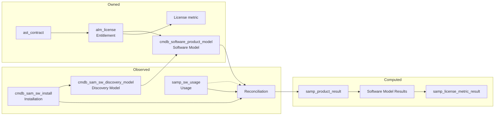
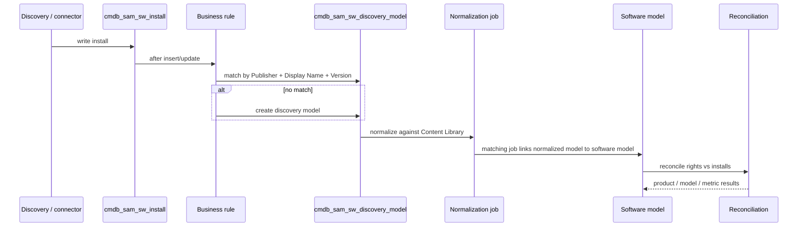

# ServiceNow SAM Module — Guide (v2)

> **Status legend:** **V** = verified against official ServiceNow documentation; **C** = corroborated by a second independent source; **U** = unverified or instance-dependent; **P** = recommended practice, not a product constraint.
> **Release pin:** SAM pages — **Brazil** (updated 2025-07-31 → 2026-10-19); IRE pages — **Australia** (2026-03-12 → 2026-03-24). See [`08_SOURCE_NOTES.md`](08_SOURCE_NOTES.md).
> **Scope:** software asset management configuration and operation. No live instance was used in this pass; every instance-specific name is marked **U** with a verification query.

---

## 1. What SAM is

Software Asset Management (SAM) answers one operational question:

> **Are we legally and financially in control of the software we actually run?**

It reconciles two independent truths:

| Truth | Source | Record chain |
|---|---|---|
| **What we own** | Contracts, purchase orders, entitlements | `ast_contract` → `alm_license` → software model → license metric |
| **What exists and is used** | Discovery, SCCM/Intune/Jamf, usage connectors | `cmdb_sam_sw_install` → `cmdb_sam_sw_discovery_model` → software model; usage is product-level and references CI/user, not the install record |

Reconciliation compares those streams per software model and per license metric and produces a compliance position. Everything else — reclamation, true-up, renewals, audit defence — is downstream of that calculation. **V**

SAM's documented feature areas are **dashboards, licensing, discovery and normalization, reconciliation, optimization (reclamation), and downgrade rights**. **V**

---

## 2. SAM vs HAM vs ITAM

| Aspect | HAM | SAM | ITAM (umbrella) |
|---|---|---|---|
| Tracks | Physical assets | Software entitlements, installs, usage | Both |
| Core question | What do we own, where is it, who has it? | Are we compliant and cost-efficient? | Full asset portfolio |
| Core records | `alm_asset`, `alm_hardware` | software model, discovery model, install, entitlement, reconciliation result | `alm_*` hierarchy |
| Key engine | Asset lifecycle | Reconciliation | Both |
| Typical owner | IT operations / desktop | SAM administrator / license manager | ITAM manager |

**Shared, not interchangeable:** both use `alm_asset` and `ast_contract`, but only SAM has the **install → discovery model → software model → entitlement → reconciliation** chain. **V/C**

---

## 3. Editions and plugins — get this right first

SAM Foundation and SAM Professional are different products with different plugin IDs. Treat plugin IDs as release-pinned and verify in **System Applications → All Available Applications** before quoting them.

| Capability | Plugin (Brazil evidence) | Notes |
|---|---|---|
| SAM Professional master (Brazil+) | `com.sn_samp_master_ws` | Loads `com.sn_samp_master` + `sn_sam_workspace` in one step. **V** |
| SAM Professional (pre-Brazil) | `com.sn_samp_master` | Loads `com.snc.samp` + publisher packs + UI components. **V** |
| SAM Professional core (older) | `com.snc.samp` | Loaded by the master plugin. **V** |
| SAM Foundation | `com.snc.sams` | Separate edition; reconciliation page names it explicitly. **V** |
| Software Asset Workspace | `sn_sam_workspace` | Store app loaded by the master plugin. **V** |
| ML normalization | `com.sn_sam_ml_normalization` | Optional; property `com.snc.samp.enable.ml_normalization`. **V** |
| SaaS License Management | `sn_sam_saas_int` | Store request; adds Subscription and Consumption metric groups. **V** |
| Spend Detection | `com.sn_sam_spend` | Financial transaction analysis. **V** |
| Engineering Applications | `com.sn_samp_eng_app` | Concurrent licenses (OpenLM / Open iT). **V** |
| Publisher packs | Adobe, Citrix, IBM, Microsoft, Oracle, SAP, VMware | Per-publisher metrics and rules. **V** |
| SCCM legacy | `com.snc.integration.sccm2012v2`, `com.snc.integration.sccm2016`, usage variants | Documented as *will be deprecated in the Tokyo release*; prefer the Service Graph connector for new integrations. **V** |

> **Conflict, not smoothed over:** the repo's v1 documents also cite `com.snc.samp` for pre-Xanadu and `com.snc.sams` for Foundation. Those are compatible with the Brazil component page; the important correction is that **`com.sn_samp_master_ws` is the Brazil master**, not `com.sn_samp_master`. See [`../CONFLICT_LOG.md`](../CONFLICT_LOG.md) C-01.

---

## 4. The record chain (the core mental model)

| Record | Table (Brazil) | Plain-English meaning | Created by |
|---|---|---|---|
| Software model | `cmdb_software_product_model` | Canonical purchased product / version profile | Content Library auto-create or SAM admin |
| Discovery model | `cmdb_sam_sw_discovery_model` | Raw fingerprint observed in the field | Discovery / connector business rule; **never manually** |
| Installation | `cmdb_sam_sw_install` | One concrete install on one device | Discovery / SCCM / connector |
| Usage | `samp_sw_usage` | Evidence the software was actually used; **product-level**, references publisher/product + CI + user, not the install record | Usage connectors or manual |
| Entitlement | `alm_license` | Right to use N units under a metric | SAM admin / import |
| Reconciliation run | `samp_reconciliation_result` | One run of the engine | Scheduled or on-demand run |
| Product result | `samp_product_result` | Product-level compliance, cost, savings | Reconciliation |
| License metric result | `samp_license_metric_result` | Rights owned / used / available per metric | Reconciliation |

**V** for all table names above. `samp_reconciliation_result` is named explicitly on the Software Asset Overview page as the source of the "Last reconciliation failure/completed" alert. **V**

**Rule of thumb:** *software model = what it is; entitlement = what you may use; installation = what exists; usage = what is used; reconciliation = the difference.* **P**

> **Correction to a common guide claim:** the installation record references the **discovery model**, not the software model. The software-model reference lives on the discovery model. **V** See [`../CONFLICT_LOG.md`](../CONFLICT_LOG.md) C-04.

---

## 5. Three planes — do not conflate them

| Plane | Question | Configured in | Governs |
|---|---|---|---|
| **CMDB identity (IRE)** | Is this CI the one I already have? | CI Class Manager: identification, reconciliation, data refresh, IRE data source rules | CIs (servers, laptops, network gear) |
| **SAM software identity** | Are these two software titles the same product? | Content Library, normalization rules, discovery-model matching | Installs and discovery models |
| **Commercial rights** | How is the product counted, and do we own enough? | Software model, entitlement, license metric | Rights and compliance |

**The boundary that matters:** IRE does **not** match software installs to discovery models. SAM uses a business rule and the discovery-model primary key (**Publisher + Display Name + Version**). IRE still governs the **CI** that the install points at. Deduplicating a *machine* is IRE; deduplicating a *software title* is SAM normalization; deduplicating *rights* is a license-metric decision. **V/P**

See [`02_CMDB_IRE_GOVERNANCE.md`](02_CMDB_IRE_GOVERNANCE.md) for the full IRE rule model and its insert/update applicability.

---

## 6. The four gates before any compliance number is defensible

| Gate | What must be true | Evidence |
|---|---|---|
| **1. Schema + edition** | SAM plugin active; correct edition; `samp_*` and `cmdb_sam_*` tables present | Plugin list, `sys_db_object` query |
| **2. CMDB populated + CI identity** | CIs exist, identification rules produce one CI per device | `cmdb_ci` count; identifier rules; duplicate tasks |
| **3. Discovery feed** | At least one trusted source populates installs | `discovery_source` on sample CIs; install count trend |
| **4. Normalization + entitlements** | Models normalize; every entitlement links to a model and a metric | Normalization status distribution; orphan entitlement query |

A number produced before all four gates are clear is a draft, not a compliance position. **P**

---

## 7. End-to-end order of operations

### 7.1 Setup order

1. Confirm edition and activate the correct master plugin. **V**
2. Install in-scope publisher packs and optional plugins (ML, SaaS, Spend, Engineering). **V**
3. Assign roles: `sam_admin`, `sam_user`, `sam_developer`, `sam_integrator` as needed. **V**
4. Load foundation data: companies, locations, departments, cost centers, users. **P**
5. Configure **one** discovery/connector feed first (SCCM/Intune Service Graph, Discovery, or ACC). **P**
6. Confirm CI identification rules for computer classes (CMDB/IRE, not SAM config). **C** (IRE is Australia-pinned; see [`02_CMDB_IRE_GOVERNANCE.md`](02_CMDB_IRE_GOVERNANCE.md))
7. Verify Content Library download and normalization job success. **V**
8. Normalize the top software titles; resolve `Match Not Found` before scaling. **P**
9. Create entitlements from contracts/POs; link each to a software model and metric. **V**
10. Run reconciliation; treat the first run as a **data-quality loop**, not a true-up invoice. **P**
11. Configure reporting, health check, and ownership. **V**
12. Publish scope in phases if using `com.snc.samp.manage.published.products`. **V**

### 7.2 Runtime order

**V** for the install → discovery-model business rule and primary key; **V** for the normalization job; **V** for the three-tier reconciliation output.

---

## 8. Insert vs update — the layered answer

There is no single "SAM insert/update rule". Each layer has its own gate:

| Layer | Insert gate | Update gate | Where configured |
|---|---|---|---|
| **CI (CMDB)** | Identification finds no match; IRE data source rule does not block the class/source | Reconciliation rules decide which source may overwrite which attribute; data refresh decides staleness | CI Class Manager |
| **Installation** | Discovery writes a new row for a new install | Same discovery-model reference reused; install row updated | Discovery business rule |
| **Discovery model** | Created automatically by the business rule; **cannot be created manually** | Normalization / manual normalization updates normalized fields and status | SAM normalization |
| **Software model** | Auto-created when properties allow, or created manually | Model matching / admin edit | SAM model management |
| **Entitlement** | Created or imported; PPN may auto-create a model | Admin edit / true-up records (never overwrite history) | Entitlement form / import |
| **Reconciliation result** | New run creates new results | Results are historical; re-run instead of editing | Reconciliation job |

**V** for the CMDB and discovery-model gates; **P** for the "never overwrite entitlement history" rule.

---

## 9. Where to work (workspace first)

| Task | Brazil-preferred path | Classic path (limited support) |
|---|---|---|
| Overview / alerts | Software Asset Workspace → Software asset overview | — |
| Discovery models | Software Asset Workspace → License operations → Discovery models | `All > Software asset > Discovery > Discovery models` |
| Normalize a model | Workspace → Discovery models → Normalize | Legacy discovery-model form |
| Software models | Workspace → Software models | `All > Software asset > ...` |
| Entitlements | Workspace → License operations → Entitlements | `All > Software asset > Licenses > All` |
| Reconciliation results | Workspace → License usage | `All > Software asset > Reconciliation > Historical Results` |
| Usage | Workspace → License operations → Discovery → Software usage | `All > Software asset > Discovery > Software usage` |
| Properties | `All > Software asset > Administration > Properties` | Same |
| Health check | Health Check dashboard (Store app) | — |

**V** for the entries explicitly named in the Brazil pages; **U** for exact breadcrumb wording in your release. Classic UI support becomes limited **from Brazil**, and after activating `com.sn_samp_master_ws` you **cannot access the classic UI** at all. **V** Prefer the workspace.

---

## 10. Roles

| Role | Purpose | Contains (Brazil) |
|---|---|---|
| `sam_admin` | Full SAM administration: import entitlements, reclamation rules, reconciliation, custom products, pattern rules, Content Service | `sam_user`, `sam_spend_import`, `asset`, `model_manager`, `contract_manager` |
| `sam_user` | All SAM features except administration; view reconciliation; manual normalization | `pa_viewer`, `cmdb_read`, `report_user`, `sn_remote_dir_sync.reader` |
| `sam_developer` | Script-writing privileges comparable to a trained sysadmin | `sam_admin` |
| `sam_integrator` | Create and manage SaaS integration profiles | `sam_user`, `connection_admin`, `flow_operator` |
| `sam_spend_import` | Import financial transaction data into Spend Detection | `pa_viewer` |

**V** (Brazil "Components installed with SAM Professional"). **`sam_license_manager` and `sn_sam.admin` are not official role names** — do not use them in runbooks. **C**

---

## 11. Maturity model

| Stage | Focus | Exit criterion |
|---|---|---|
| **Crawl** | Healthy CMDB, one or two discovery sources, simple licensing, roles and process | Top titles normalized; every entitlement traceable to a document **P** |
| **Walk** | More complex licensing, datacenter, BYOL, SaaS, metering and reclamation | Reconciliation explains the top gaps; reclamation is governed **P** |
| **Run** | Standardized, automated catalog and onboarding; continuous right-sizing | KPIs owned; renewals driven by reconciled demand **P** |

**V** for the stage descriptions (Brazil maturity page). The **exit criteria** are programme recommendations (**P**), not product guarantees. Use the stage to decide scope, not to justify skipping gates.

---

## 12. Scope and exclusions

**In scope in this reference:** discovery-to-SAM pipeline, normalization, deduplication, entitlements, license metrics, reconciliation, reporting, configuration, operations.

**Explicitly out of scope / not solved here:**

- Container and Kubernetes licensing (publisher-specific and contract-specific). **U**
- Publisher audit defence beyond the evidence chain described here. **P**
- Exact business-rule, UI-policy, ACL, and `sys_id` names — these are instance-specific and must be verified. **U**
- Any claim that a specific job runs at a specific hour unless the official page states it. **U**

---

## 13. Top risks and controls

| Risk | Consequence | Control |
|---|---|---|
| Duplicate CIs | Inflated install demand | IRE identification rules + duplicate tasks |
| Unnormalized titles | Unlicensed / Unknown positions | Normalization gate before auto-create |
| Metric mismatch (model vs entitlement) | Silently meaningless result | Match metric on both sides; test with one model |
| Multiple discovery sources | Duplicate installs | Dedup rules + one primary source per platform |
| Installs on retired/stolen CIs | Phantom demand | Retired/Stolen CI status **deletes** related installs; for leased or out-of-scope devices use the exclude-CI flag + `SAM — Adjust Installs for excluded CIs` |
| Maintenance treated as a license | False compliance | Separate maintenance from usage rights |
| First reconciliation treated as invoice | Wrong true-up | Data-quality loop, then re-run |
| No owner for SaaS connectors | "No waste" illusion | Connector health + owner |

**V/P** as marked in the linked deep-dive documents.

---

## 14. Read next

| Document | What it answers |
|---|---|
| [`02_CMDB_IRE_GOVERNANCE.md`](02_CMDB_IRE_GOVERNANCE.md) | Identification, reconciliation, data refresh, and data source rules — and their insert/update applicability |
| [`03_DISCOVERY_TO_SAM_PIPELINE.md`](03_DISCOVERY_TO_SAM_PIPELINE.md) | How installs become discovery models, and how duplicates are controlled |
| [`04_NORMALIZATION_AND_DEDUP.md`](04_NORMALIZATION_AND_DEDUP.md) | Six statuses, rule families, manual normalization, dedup levels |
| [`05_ENTITLEMENTS_METRICS_RECONCILIATION.md`](05_ENTITLEMENTS_METRICS_RECONCILIATION.md) | Entitlements, PPN, metrics, three-tier results, reporting |
| [`06_CONFIGURATION_REFERENCE.md`](06_CONFIGURATION_REFERENCE.md) | Plugin, role, table, property, job, and UI inventory |
| [`07_OPERATIONS_RUNBOOK.md`](07_OPERATIONS_RUNBOOK.md) | Setup, verification, troubleshooting, rollback, audit evidence |
| [`../GUIDE_CROSS_REFERENCE.md`](../GUIDE_CROSS_REFERENCE.md) | How this reference maps to (and corrects) the public SAM learning guide |
