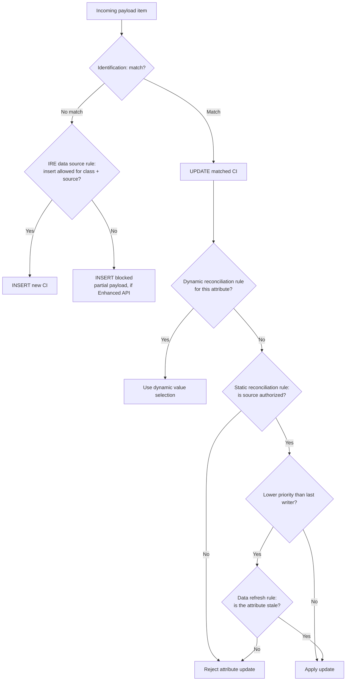

# CMDB IRE Governance for SAM

> **Status legend:** **V** verified against official ServiceNow documentation; **C** corroborated; **U** unverified/instance-dependent; **P** practice.
> **Release pin:** IRE pages — **Australia** (updated 2026-03-12 → 2026-03-24). SAM pages — **Brazil**.
> **Why this is in a SAM document:** SAM counts software **on CIs**. If the CMDB has duplicate CIs, the same install is counted twice and the compliance position is wrong before reconciliation starts.

---

## 1. The IRE model in one page

The **Identification and Reconciliation Engine (IRE)** is the rule-based engine that processes incoming CI payloads before data is written to the CMDB. **V**

It uses four rule families:

| Rule family | Question it answers | Scope | Insert | Update |
|---|---|---|---|---|
| **Identification rules** | Is this CI new, or the one I already have? | Per CI class; child classes derive from parent unless overridden | **Yes** — no match → create | **Yes** — match → update |
| **Reconciliation rules** (static / dynamic) | Which source may write this attribute? | Per class + source + attribute (or "all attributes") | **No** | **Yes** |
| **Data refresh rules** | Has the current source gone stale? | Per class + source | **No** | **Yes** — permits a lower-priority source after the effective duration |
| **IRE data source rules** | May this source create this class? | Per class + source; one active rule per pair | **Yes** — blocks insert | **No** — update still allowed |

**C** for the "four families" framing: the official pages enumerate identification, reconciliation, and IRE data source rules, and document data refresh as a reconciliation-related task. **V** for each family's insert/update applicability; see *IRE overview*, *Reconciliation rules*, *Create a CI reconciliation rule*, and *Create an IRE data source rule*.

**Fifth control, not one of the four:** **Dynamic IRE** (CMDB 360) can replace static reconciliation instance-wide. **V** The per-class exclusion mechanism (`cmdb_dynamic_ire_skip_class`) is **C/U** — secondary evidence only.

---

## 2. The processing order (the rule that prevents most confusion)



**Order to memorize:** **identify first**. On a match, reconciliation is evaluated and data refresh is considered **as part of reconciliation** (not as a separate later step). On no match, the data source rule gates the insert. **V** for "identify first" and "reconciliation is update-only"; **C** for presenting data refresh as a separate step.

**Reconciliation is not applied when IRE inserts a new CI.** **V**

This is the same order shown in the swarm methodology diagram: *Identification Rules → Reconciliation Rules → Data Refresh Rules → IRE Data Source Rules*. The diagram's placement of the data source rule at the end is conceptual; in the engine it is evaluated on the **insert** branch after identification finds no match. See [`../CONFLICT_LOG.md`](../CONFLICT_LOG.md) C-06.

---

## 3. Identification rules

### 3.1 What they do

Identification determines whether an incoming CI already exists. IRE can identify by:

1. **`source_name` + `source_native_key`** from the optional `sys_object_source_info` payload block — the faster path; or
2. **Identification criterion attributes** defined in identifier entries — the matching-algorithm path.

If `source_name` and `source_native_key` are supplied, IRE can skip the slower matching algorithms. The property `glide.identification_engine.skip_sys_object_source_matching` can be used to prioritize IRE identification rules instead. **V**

### 3.2 Identifier tables and evaluation

| Table | What it stores |
|---|---|
| `cmdb_identifier` | Identifier rules |
| `cmdb_identifier_entry` | Identifier attributes (criterion entries) |

Identifiers and attributes are parsed in **order** from low to high. Custom identifiers must use different order values from the base rules. A rule applies to a CI class or table; the **Hardware Rule** uses serial number, serial-number type, name, IP, and MAC, with related search on `cmdb_serial_number` and `cmdb_ci_network_adapter`. **V**

### 3.3 Inclusion rules and partial payloads

- An **identification inclusion rule** can restrict which rows of a class participate (for example, only `Operational` CIs). With no inclusion rule, all CIs are included. **C**
- **Partial payloads** store items that cannot yet be uniquely identified; they are kept in `cmdb_ire_partial_payloads` and retried when a later payload supplies the missing data. **V**
- **Incomplete items** are stored in `cmdb_ire_incomplete_payloads` for logging and are never reprocessed. **V**
- Partial payloads older than 90 days are deleted. **V**

### 3.4 Duplicate handling

`glide.identification_engine.skip_duplicates` and `.threshold` control how IRE handles multiple matches. Defaults are **`true` / `5`**. **V** Below the threshold, the oldest match becomes the main CI and the others are marked `duplicate_of`; above the threshold, the match fails and an error is logged. **V**

IRE stores identifier keys for partial items in the **CMDB IRE Partial Payloads Index [`cmdb_ire_partial_payloads_index`]** table and uses them to match later payloads. **V**

---

## 4. Reconciliation rules (the update gate)

### 4.1 Static rules

A static reconciliation rule authorizes a discovery source to update specific class attributes, and sets priority among sources. **V**

Key precedence rules:

1. **Specific-attribute rule** beats an **Apply to all attributes** rule, regardless of priority. **V**
2. A rule defined **directly for the class** beats a rule **derived from a parent**. **V**
3. Between rules at the same level, **priority** decides; smaller number = higher priority. **V**
4. **Child-class rules override parent-class rules** for the overridden attribute. **V**
5. Overlapping static rules for different sources on the same attribute can coexist; they prevent overwriting, not authorization. **V**

Static rules are stored in `cmdb_reconciliation_definition`. **V**

### 4.2 Dynamic rules

Dynamic reconciliation rules use CMDB 360 data to select a value (for example, largest or most reported) rather than source priority. Dynamic rules require CMDB 360, are stored in `cmdb_dynamic_reconciliation_definition`, and **take precedence over static rules for the same attribute at the same class level**. A child class's **static** rule can still override a parent class's **dynamic** rule. Only one dynamic rule can exist per class attribute. **V**

When no value is conclusive, IRE falls back to last reported / last discovered / last updated details. **V**

### 4.3 Null and filter conditions

- By default, an authorized source cannot overwrite a non-null value with null. Attributes that may be nulled must be listed in **Update with Null**. **V**
- A **Filter Condition** restricts the rule to a row subset (for example, `[Department] [is] [Finance]`). **V**
- `glide.identification_engine.enable_reconciliation_filter_before_update` controls whether the filter is applied before or after attribute values change. The default `false` is **V**; the exact before/after mapping is inferred from the property description and is **C**.

### 4.4 What cannot be reconciled

You cannot create a reconciliation rule for **system fields** or **IRE-specific fields** such as `discovery_source`, and rules cannot be dot-walked through reference fields. **V**

---

## 5. Data refresh rules (staleness)

A data refresh rule defines an **Effective Duration** for a class/source pair. If the last writer's value is older than that duration, a lower-priority authorized source may update it. **V**

The last writer per attribute is recorded in the **Data Source History** table `cmdb_datasource_last_update` — but only after the reconciliation rule is enabled, so expect a settling period. **V**

**First-writer exception:** a lower-priority source is rejected unless it is the **first source updating the CI**, or the CI attribute is **stale** according to the data refresh rule. **V**

**Important:** a rule that applies to **all attributes** does not outrank a lower-priority rule that applies to a **specific attribute**, even when the CI is stale. **V**

**Recency side effect:** IRE always updates `last_discovered` and `discovery_source` during payload processing, even when no other attribute is updated. A payload `last_discovered` is adopted only if it is newer than the CMDB value. **V** The `sys_object_source.last_scan` side has separate properties (`skip_updating_last_scan_if_older`, `ire_message_listener_skip_updating_last_scan_to_now`). **V**

The data refresh rule UI/table name is not consistently exposed in the fetched pages; use **CI Class Manager → Class Info → Reconciliation Rules → Add → data refresh** and verify the generated definition. **U**

---

## 6. IRE data source rules (the insert gate)

An IRE data source rule prevents a named source from **inserting** new CIs of a class while still allowing it to **update** existing CIs. **V**

| Field | Meaning |
|---|---|
| `Active` | Enables the rule |
| `Applies to` | Class (and child classes) the source may not create |
| `Data source` | The source being restricted |
| `Insert Not Allowed` | Blocks inserts for the class/source pair |

**V**

Behavior on a blocked insert:

- The insert fails with `INSERT_NOT_ALLOWED_FOR_SOURCE`. **V**
- With `CreateOrUpdateCIEnhanced()`, the payload item is stored as a partial payload for later matching. **V**
- With plain `createOrUpdateCI()`, the **entire payload fails** because partial commits are not supported. **V**
- If a permitted source later inserts the same CI, IRE merges the partial payload, deletes it, and the previously blocked source may then update the CI. **V**

**Caveats:** IRE data source rules do not apply to lookup/related items; only one rule can be active per class/source pair; child classes derive parent rules but a child rule overrides; and the rules have **no impact when dynamic reconciliation rules are in effect**. **V**

---

## 7. The SAM boundary — what IRE does *not* do

| Question | Governed by | Not governed by |
|---|---|---|
| Is this CI new? | IRE identification | SAM |
| Which source may update `name` / `serial_number`? | IRE reconciliation + data refresh | SAM |
| May this source create this CI class? | IRE data source rule | SAM |
| Is this software install the same as an existing discovery model? | SAM business rule + discovery-model primary key | IRE |
| Are these two software titles the same product? | SAM normalization / Content Library | IRE |
| Which CI does this install point at? | `cmdb_sam_sw_install` "Installed on" → CMDB CI (API column `installed_on` is **U**) | SAM normalization |

**V/P.** The most common architecture error is to describe normalization as "IRE for software". It is not. IRE is a CMDB CI mechanism; SAM's software identity is a separate normalization pipeline.

---

## 8. Configuration paths

| Task | Path |
|---|---|
| Identification rules | `All > Configuration > CI Class Manager` → class → Class Info → Identification |
| Reconciliation rules | CI Class Manager → class → Class Info → Reconciliation Rules |
| Data refresh rules | CI Class Manager → class → Reconciliation Rules → Add → data refresh |
| IRE data source rules | `All > Configuration > Identification/Reconciliation > IRE Data Source Rule` |
| Reconciliation definitions | `All > Configuration > Identification/Reconciliation > Reconciliation Definitions` |

**V** for the reconciliation, reconciliation-definition, and IRE-data-source-rule paths. **C/U** for the identification and data-refresh paths (reconstructed from CI Class Manager navigation). Roles: `sn_cmdb_admin` / `itil_admin` for full access; `sn_cmdb_editor` / `itil` for read. **V**

---

## 9. Properties that change behavior

Treat defaults as release-pinned. Verify in **Properties for Identification and Reconciliation** before relying on them.

| Property | Effect | Default (as reported) |
|---|---|---|
| `glide.required.attribute.enabled` | Required attributes cannot be null during identification/reconciliation | `true` **V** |
| `glide.identification_engine.skip_duplicates` + `.threshold` | Auto-pick oldest duplicate and mark others; threshold controls fallback | `true` / `5` **V** |
| `glide.identification_engine.enable_identifier_optional_condition` | Advanced conditions on regular identifier entries | `false` **V** |
| `glide.identification_engine.skip_sys_object_source_matching` | Prefer IRE identification over `source_native_key` lookup | `false` **V** |
| `glide.reconciliation.override.null` | Allow a lower-priority source to fill an empty field | `true` **V** |
| `glide.identification_engine.enable_reconciliation_filter_before_update` | Apply filter condition before vs after value change | `false` **V** |
| `glide.identification_engine.dynamic_ire_enabled` | Use dynamic IRE instead of static IRE | `false` **V** |
| `glide.identification_engine.skip_updating_source_last_discovered_if_older` | Do not back-date `last_discovered` | `true` **V** |
| `glide.identification_engine.granular_insert_locking` | Multiple granular locks vs a single global insert lock | `true` **V** |
| `glide.identification_engine.batch_update_last_discovered` | Batch-update `last_discovered` | `true` **V** |

These defaults are stated on the official *Properties for Identification and Reconciliation* page (Australia). If your release differs, that page wins.

---

## 10. Verification queries

Run these in a sub-production instance before declaring the CMDB gate passed.

```text
# Identifier rules and entries
cmdb_identifier.list
cmdb_identifier_entry.list

# Reconciliation definitions (static and dynamic)
cmdb_reconciliation_definition.list
cmdb_dynamic_reconciliation_definition.list

# IRE data source rules
cmdb_ire_data_source_rule.list

# Data source history (only populated after a rule is enabled)
cmdb_datasource_last_update.list

# Partial and incomplete payloads
cmdb_ire_partial_payloads.list
cmdb_ire_partial_payloads_index.list
cmdb_ire_incomplete_payloads.list

# Duplicate / reclassification tasks (table/label is U; filter by task type)
task.list
```

**U** for table/field labels in your release; **V** for the table names stated in the official IRE pages.

---

## 11. Failure modes and controls

| Symptom | Likely IRE cause | Verify | Control |
|---|---|---|---|
| Same server appears twice | Identification rule too weak (name only) | Compare criterion attributes and serial number | Add serial number / MAC; use class-specific rule |
| Source cannot update a field | No reconciliation rule authorizes it | `cmdb_reconciliation_definition` | Add a specific-attribute rule |
| A source keeps overwriting another | No priority or overlapping rules | Reconciliation rule priority | Set priority; use child-class override |
| Lower-priority source cannot correct a stale value | Data refresh rule missing or not stale yet | `cmdb_datasource_last_update` + effective duration | Add/adjust data refresh rule |
| A trusted source cannot create a class | IRE data source rule blocks it | `cmdb_ire_data_source_rule` | Narrow or disable the rule |
| Partial payloads accumulate | Missing dependency data | `cmdb_ire_partial_payloads` | Fix feed order/completeness; purge after 90 days |
| Duplicate tasks spike after a feed change | Payload keys or criterion attributes changed | Duplicate task details | Change control; test in sub-prod |

**V/P.**

---

## 12. What remains unverified

- Exact `sys_id` values, UI action names, and business-rule names in your instance. **U**
- The table name for data refresh definitions in your release. **U**
- Whether your instance uses static or dynamic IRE; check `glide.identification_engine.dynamic_ire_enabled` and `cmdb_dynamic_ire_skip_class`. **U**
- Publisher-specific CI attributes (for example, Oracle host affinity) — see the SAM publisher-pack pages. **U**
- Partial payload item limit (`glide.identification_engine.partial_payload_items_max_size`, default 1000) and payload-splitting behavior for large SCCM feeds. **V** for the default; **U** for your feed size.
