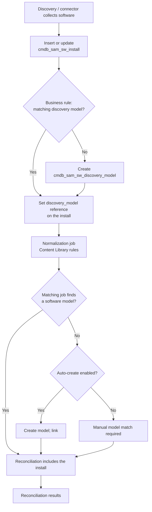

# Discovery → SAM Pipeline

> **Status legend:** **V** verified against official ServiceNow documentation; **C** corroborated; **U** unverified/instance-dependent; **P** practice.
> **Release pin:** **Brazil** (SAM pages updated 2025-07-31 → 2026-10-19).

---

## 1. Sources

| Source | How it feeds SAM | Preferred for |
|---|---|---|
| **ServiceNow Discovery** | Writes `cmdb_sam_sw_install`; patterns for servers and applications | Datacenter / network-reachable devices |
| **Service Graph Connector for Microsoft SCCM** | Modern replacement for legacy SCCM plugins | Windows desktop/server estate |
| **Service Graph Connector for Intune** | Modern endpoint feed | Windows/mobile managed estate |
| **Service Graph Connector for Jamf Pro** | macOS/iOS feed | Apple estate |
| **Agent Client Collector (ACC)** | Lightweight endpoint agent | Endpoints without network scans |
| **Third-party tools** | Import/API into the install table or CMDB | Specialized estates |

**V** for Discovery and SCCM, and for the statement that legacy SCCM plugins *will be deprecated in the Tokyo release*. **V** for the **SCCM** Service Graph connector as the documented replacement path. **U** for the Intune/Jamf Service Graph connectors in the Brazil SAM pages; those are corroborated by the broader ITAM/connector set, not by the fetched SAM pages.

**One primary source per platform class** is the simplest way to avoid duplicate installs. If you must run two, configure deduplication deliberately (see §5). **P**

---

## 2. Runtime sequence

**V** for the business rule, the install table, the discovery-model table, and normalization.

---

## 3. Step 1 — installs land in `cmdb_sam_sw_install`

Discovery populates the **Software Installation** table. A primary key is built from **Publisher, Display Name, and Version**. **V**

The install record references a **Discovery model**, not a software model. **V**

> **Correction to v1 and to the public guide:** v1's module reference listed the discovery-model primary key as *Publisher + Product + Version + Edition*. The official Brazil page states **Publisher + Display Name + Version**. Edition is a normalized field on the discovery model, not part of the documented primary key. **V** See [`../CONFLICT_LOG.md`](../CONFLICT_LOG.md) C-03.

### 3.1 Install fields that affect reconciliation

| Field | Why it matters |
|---|---|
| **Discovery model** | The link to the normalized fingerprint; the install does not reference the software model directly. **V** |
| **Edition Override** | Set an edition that Discovery did not report so reconciliation can proceed. **V** |
| **Inferred suite** | The suite model this install rolls up to. **V** |
| **Omit from suites** | Excludes the install from suite component counting. **V** |
| **Prod id / Revision / Entitlement** | Deprecated fields; still displayed empty. **V** |

The install list count is capped by `sn_sam_workspace.sam_license_operations_list_count` (default `5000000`; above that it displays `5000000+`). **V**

---

## 4. Step 2 — the business rule matches or creates a discovery model

When install records are written, a business rule checks whether the unique combination of discovered publisher, discovered product, and discovered version already exists in the discovery-model table. **V**

| Outcome | Behavior |
|---|---|
| Match found | The discovery-model reference is set on the install; existing model is reused. **V** |
| No match | A new discovery model is created and referenced. **V** |
| Software name contains `Security Update` | No discovery model is created. **V** |

**Discovery models cannot be created manually.** They are created by Discovery. **V**

### 4.1 Version matching and rounding

When matching to an existing software model, an exact version is searched first; if absent, the match rounds down to the major version. Example: `8.0.4` can match `8.0`. **V**

### 4.2 Product type gate

The discovery model carries a **Product type** (`Child`, `Driver`, `Licensable`, `Not Licensable`, `Patch`, `Unknown`). **Reconciliation only considers discovery models that are licensable.** Changing the product type updates the normalization status to `Manually Normalized`. **V**

---

## 5. Duplicates and deduplication (Brazil)

Without deduplication, upgrades, incomplete removals, and multiple discovery sources inflate install counts and therefore demand. **V**

### 5.1 Deduplication levels

Starting with Brazil, deduplication is configurable per product with three version-matching levels:

| Level | Behavior | Use for |
|---|---|---|
| **Exact** | Duplicate only when the **normalized version and normalized edition** match exactly; the most conservative level | Discrete version lifecycles |
| **Major** | Same major version is duplicate regardless of point release; **default when no custom rule exists**; unparseable versions are skipped | Most enterprise software |
| **Any** | One install per product/edition per device, regardless of version; the most aggressive level | Volatile/auto-updating software (for example Chrome) |

**V**

### 5.2 Primary selection

After duplicates are identified, the **SAM deduplication logic** selects the primary record using tiered criteria, evaluated in order. IRE is not involved in software-install deduplication.

1. **Discovery source reliability** — more reliable sources preferred. **V**
2. **Information completeness** — more complete records preferred. **V**
3. **Installation version** — latest version preferred. **V**

### 5.3 Custom rules

A product must exist as a normalized record in `cmdb_software_product_model` before a dedup rule can be assigned. **V**

| Field | Meaning |
|---|---|
| Product | Normalized product the rule applies to |
| Active | Rule enabled |
| Version Level | `Major`, `Exact`, or `Any` |
| Stale Record Threshold (Days) | Days after which an unrefreshed record is stale |

Rules are stored in `sam_sw_dedup_rule`. **V**

Navigate: **Software Asset Workspace → Administration → Deduplication rules → New**. Role required: `sam_admin`. **V**

### 5.4 What dedup does and does not fix

Dedup consolidates **install records on the same device**. It does not fix duplicate **CIs** (that is IRE) and does not fix duplicate **software models** (that is normalization/model matching). **V/P**

---

## 6. Step 3 — normalization

Normalization compares discovered publisher, product, version, and edition against the **SAM Content Library** and writes matched values to the normalized columns on the discovery model. Those normalized values drive reconciliation, license position, and lifecycle. **V**

Full detail: [`04_NORMALIZATION_AND_DEDUP.md`](04_NORMALIZATION_AND_DEDUP.md).

---

## 7. Step 4 — discovery model → software model

After normalization, a scheduled job, **`SAM – Discovery Model to Software Model matching`**, links discovery models to software models:

- For each **normalized publisher + normalized product** pair, it finds software models with matching publisher and product. **V**
- It matches the **most specific** model first; if no specific model exists, it uses the **most generic** model. **V**
- A model with an **install condition** (or subscription condition / DB option) is **not** considered a match. In that scenario, if auto-create is enabled, a new model without an install condition is created. **V**
- On a match, the software-model reference is written to the **Software model** column on `cmdb_sam_sw_discovery_model`. **V**
- A manual model override unchecks **Automatically matched**; the job will not overwrite that value on later runs. **V**

> **Correction to v1:** the older "Display Name + Publisher + Version / Display Name + Version / Display Name only" fallback description is **C/U** — it is not stated in the Brazil pages. Use the job behavior above. See [`../CONFLICT_LOG.md`](../CONFLICT_LOG.md) C-21.

A software model can cover multiple discovery models. Example: a model defined as `Publisher = X`, `Product = Y`, `Version starts with 10` maps discovery models for 10.1 and 10.2 to the same model. **V**

### 7.1 Automatic model creation

| Property | Effect |
|---|---|
| `com.snc.samp.automaticsmrcreation` | Automatically creates a software model for **licensable** products with no match |
| `com.snc.samp.automaticsmcreation` | Automatically creates a software model for **not licensable** products |
| `com.snc.samp.unlicensed_smr_creation` | **Disables** creation of software-model results for unlicensed models when False; when True, creates them |

**V**

If the auto-create properties are enabled and a discovery-model match exists — even a generic one — **no** software model is created. If the properties are disabled, the job only matches; it does not create models. A model is created across versions and for the specific edition, if available, but **never against a specific version**. **V**

> **Practice:** keep `automaticsmrcreation` off until normalization is stable; enabling it early creates models for bad fingerprints. **P**

---

## 8. Step 5 — reconciliation

Reconciliation compares active rights to normalized installs and usage, then writes product, software-model, and license-metric results. **V**

Full detail: [`05_ENTITLEMENTS_METRICS_RECONCILIATION.md`](05_ENTITLEMENTS_METRICS_RECONCILIATION.md).

---

## 9. Insert vs update matrix (pipeline view)

| Situation | Installation | Discovery model | Software model | Reconciliation |
|---|---|---|---|---|
| New install, new fingerprint | New row | New model | Auto-create if enabled, else match later | Next run includes it |
| New install, existing fingerprint | New row | Existing model reused | Unchanged | Next run includes it |
| Same install reported again | Updated | Unchanged | Unchanged | Next run |
| Same software via two sources | Duplicate rows until dedup | Same model | Unchanged | Dedup reduces demand |
| Install removed from CI | Row remains until manually deleted | Unchanged | Unchanged | Likely still counted until deletion/exclusion **P/U** |
| CI retired/stolen | Related installs **deleted** | Unchanged | Unchanged | Demand drops **V** |
| Product type changed to Licensable | Unchanged | Status → `Manually Normalized` | May match | Now considered **V** |
| Normalization reverted | Unchanged | Status → `Match Not Found` | Link effect **U** | Excluded / unmatched **V** |

**V** for the first six rows (official business rule, dedup, removal, CI status); **V** for product type; **V** for revert. The "next run includes it" timing is **P**.

---

## 10. Stale data and uninstalled software

### 10.1 Remove uninstalled installs

Official procedure:

1. Use REST Table API `GET api/now/table/cmdb_sam_sw_install?sysparm_query=installed_on=<ci_sys_id>` to list installs on a CI. **V**
2. Identify the `sys_id`s of installs that are uninstalled. **V**
3. Delete those records with the Table API `DELETE`. **V**
4. Role required: `sam_developer`. **V**

You can also delete installs for specific publishers such as Oracle, VMware, and Citrix. **V**

### 10.2 Retired or stolen CIs

If the CI Status or Hardware Status changes to **Retired** or **Stolen**, installs related to that CI are deleted. **V**

### 10.3 Exclude CIs from SAM

Use this for leased devices or a phased rollout. **V**

1. Add a true/false column to `cmdb_ci_hardware` (for example `u_exclude_from_sam`); the column default is `false`. **V**
2. Set it to `true` on devices to exclude. **V**
3. Set the property `com.snc.samp.exclude_device_flag` to the column name. **V**
4. Wait for the job **`SAM — Adjust Installs for excluded CIs`**. **V**

Reversing: set the flag to `false`, or remove the column name from the property, and wait for the job. **V** Role required: `sam_admin`. **V**

> **Long-tail warning:** exclusion is applied by a job, not instantly. Installs remain visible to reconciliation until the job runs. **V/P**

---

## 11. CI-side display

To show SAM data on a computer CI:

1. Open a computer CI (`cmdb_ci_computer`).
2. Right-click the header → **Configure → Related Lists**.
3. Add **`Software Installation -> Installed on`**.
4. Save.

**V** (documented in the repo's v1 reference and consistent with the install table's `installed_on` field). **C**

After SAM activation, update any custom related lists or reference fields that still point at the legacy `cmdb_ci_spkg` table. **U/C** — the migration advice is from v1, not the fetched Brazil pages; verify in your release.

---

## 12. Data-quality checks

| Check | Query / evidence | Healthy signal |
|---|---|---|
| Install growth | Count `cmdb_sam_sw_install` by week | Growth matches estate change, not connector churn |
| Source mix | Group installs by `discovery_source` | One primary source per platform class |
| Duplicate rate | Dedup rule / duplicate install count | Stable after dedup rules applied |
| Unnormalized backlog | `cmdb_sam_sw_discovery_model` by normalization status | `Match Not Found` trending down |
| Orphan installs | Installs with no discovery model | Zero or explained |
| Stale installs | Installs on retired CIs | Deleted or excluded |
| Licensable share | Discovery models by product type | Licensable set matches scope |

**P**; table/field names **V** where named.

---

## 13. Unverified items

- Exact job schedule for `SAM — Adjust Installs for excluded CIs`. **U**
- Whether your SCCM integration is still a legacy plugin or already a Service Graph connector. **U**
- The exact dedup rule state on your instance (there may be no custom rules; Major is the default). **U**
- Whether your instance has manual model-matching overrides (`Automatically matched` unchecked), which the job will not overwrite. **U**
- The exact cadence of `SAM – Discovery Model to Software Model matching` in your instance. **U**
