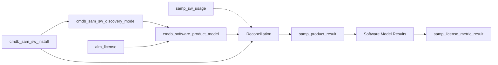

# `finalv2` — ServiceNow SAM Module Documentation

**Run:** `finalv2` discovery-swarm pass · **Date:** 2026-11-14
**Release pins:** SAM — **Brazil**; CMDB/IRE — **Australia**
**Status:** documentary reference + operable runbook. No live instance was used.
**Companion:** public SAM learning guide → <https://eltonaguiar.github.io/ServiceNow_Learning_TSOM-_CSM_FSM_SalesCRM_HAM_ITSM/docs/modules/sam/sam-guide/>

---

## What this is

A self-contained documentation set for the **ServiceNow Software Asset Management (SAM)** module, produced with the six-phase contract from the run diagram (PREREQ → PLAN → CLARIFY → PHASES → QA → FINAL), then cross-checked by subagents against the official product docs, the repo's v1 finals, and the public SAM guide.

It answers four questions:

1. **What is the SAM record chain** from a discovered install to a compliance result?
2. **Where does CMDB/IRE end and SAM begin?**
3. **How do normalization, deduplication, entitlements, metrics, and reconciliation actually fit together?**
4. **What must be configured and verified** before a compliance number is defensible?

---

## Document map

| Document | Read it for |
|---|---|
| [`01_PLAN/PLAN.md`](01_PLAN/PLAN.md) | Goal, phases, risks, success criteria |
| [`00_PREREQ/PREREQ.md`](00_PREREQ/PREREQ.md) | Capability probe and source access |
| [`02_CLARIFICATIONS/CLARIFY.md`](02_CLARIFICATIONS/CLARIFY.md) | What was blocked and how it was handled |
| [`03_PHASES/`](03_PHASES/) | Dated phase artifacts (progress is a file) |
| [`05_FINAL/01_SAM_MODULE_GUIDE.md`](05_FINAL/01_SAM_MODULE_GUIDE.md) | **Start here** — architecture, record chain, gates, order of operations |
| [`05_FINAL/02_CMDB_IRE_GOVERNANCE.md`](05_FINAL/02_CMDB_IRE_GOVERNANCE.md) | Identification, reconciliation, data refresh, data source rules; insert/update truth table |
| [`05_FINAL/03_DISCOVERY_TO_SAM_PIPELINE.md`](05_FINAL/03_DISCOVERY_TO_SAM_PIPELINE.md) | Install → discovery model → software model; dedup; stale data; exclude CI |
| [`05_FINAL/04_NORMALIZATION_AND_DEDUP.md`](05_FINAL/04_NORMALIZATION_AND_DEDUP.md) | Six statuses, rule families, manual normalization, jobs |
| [`05_FINAL/05_ENTITLEMENTS_METRICS_RECONCILIATION.md`](05_FINAL/05_ENTITLEMENTS_METRICS_RECONCILIATION.md) | Entitlements, PPN, metrics, three-tier results, reporting |
| [`05_FINAL/06_CONFIGURATION_REFERENCE.md`](05_FINAL/06_CONFIGURATION_REFERENCE.md) | Plugins, roles, tables, properties, jobs, UI, integrations |
| [`05_FINAL/07_OPERATIONS_RUNBOOK.md`](05_FINAL/07_OPERATIONS_RUNBOOK.md) | Pre-flight, setup, gates, troubleshooting, rollback, audit chain |
| [`05_FINAL/08_SOURCE_NOTES.md`](05_FINAL/08_SOURCE_NOTES.md) | Sources, release pins, evidence policy, limits |
| [`CROSS_REFERENCE_MATRIX.md`](CROSS_REFERENCE_MATRIX.md) | Claim → official source → v1 → status |
| [`GUIDE_CROSS_REFERENCE.md`](GUIDE_CROSS_REFERENCE.md) | v2 vs the public SAM guide: 21 numbered items + G-22–G-31 |
| [`CONFLICT_LOG.md`](CONFLICT_LOG.md) | Every material disagreement and its resolution |
| [`SUBAGENT_CROSSCHECK.md`](SUBAGENT_CROSSCHECK.md) | Subagent dispatch and findings |
| [`04_QA/QA.md`](04_QA/QA.md) | Score against the plan; UNVERIFIED list |
| [`06_FILESCOPE/FILESCOPE.md`](06_FILESCOPE/FILESCOPE.md) | Branch and files published |
| [`METHODOLOGY.md`](METHODOLOGY.md) | How the six-phase contract was applied |

---

## Executive summary

### The three planes

| Plane | Question | Governed by |
|---|---|---|
| **CMDB identity** | Is this CI the one I already have? | IRE: identification, reconciliation, data refresh, data source rules |
| **SAM software identity** | Are these two software titles the same product? | Content Library normalization + discovery-model matching |
| **Commercial rights** | Do we own enough, counted the right way? | Software model, entitlement, license metric |

**Do not conflate them.** IRE governs CIs. SAM does **not** use IRE to match installs to discovery models; it uses a business rule and the discovery-model primary key (**Publisher + Display Name + Version**). Deduplicating a machine is IRE; deduplicating a software title is SAM normalization; deduplicating rights is a license-metric decision.

### The record chain



### The four gates

1. **Schema + edition** — correct plugin, `samp_*` / `cmdb_sam_*` tables.
2. **CMDB + CI identity** — one CI per device; IRE rules reviewed.
3. **Discovery feed** — at least one trusted source populates installs.
4. **Normalization + entitlements** — models normalize; every entitlement has a model and metric.

A number produced before all four gates are clear is a draft.

---

## Top corrections vs v1 and the public guide

| # | Old claim | Correct position |
|---|---|---|
| 1 | Discovery-model key includes **Edition** | Key is **Publisher + Display Name + Version**; Edition is normalized, not key |
| 2 | Install references `software_model` | Install references the **discovery model**; the software model lives on the discovery model |
| 3 | Usage table `cmdb_sam_sw_usage` | **`samp_sw_usage`** |
| 4 | One `sam_sw_reconciliation_result` table | **Three tiers**: `samp_product_result` → model results → `samp_license_metric_result`; run record is `samp_reconciliation_result` |
| 5 | Reconciliation default **nightly** | **Weekly default** + on demand |
| 6 | SAM plugin `com.snc.iam` | Brazil master `com.sn_samp_master_ws`; pre-Brazil `com.sn_samp_master`; core `com.snc.samp`; Foundation `com.snc.sams` |
| 7 | Five normalization statuses / binary queue | **Six** documented statuses, including `New` |
| 8 | "Unknown" is a product compliance field | Product field is **Compliant / Not Compliant**; the six-state vocabulary is interpretive |

Full list: [`GUIDE_CROSS_REFERENCE.md`](GUIDE_CROSS_REFERENCE.md) and [`CONFLICT_LOG.md`](CONFLICT_LOG.md).

---

## Confidence marks

| Mark | Meaning |
|---|---|
| **V** | Directly stated in an official ServiceNow page read for this pass |
| **C** | Corroborated by a second source |
| **U** | Unverified / instance-dependent / release-dependent |
| **P** | Recommended practice, not a product constraint |

**U** items are listed in [`04_QA/QA.md`](04_QA/QA.md) §4 with verification queries. They are not hidden.

---

## Evidence base

| Source | What it contributed |
|---|---|
| Brazil SAM pages (khub map `PMOYmdGTPDs40EbYh10h4g`) | SAM pipeline, normalization, dedup, entitlements, metrics, reconciliation, reporting, properties, roles, plugins |
| Australia IRE pages | Identification, reconciliation, data refresh, data source rules |
| v1 `final/` docs | Discovery→SAM flow, config inventory, prior cross-reference |
| Public SAM guide | Pedagogy + the claims cross-checked in `GUIDE_CROSS_REFERENCE.md` |

Details and reproduction commands: [`05_FINAL/08_SOURCE_NOTES.md`](05_FINAL/08_SOURCE_NOTES.md).

---

## How this was produced

1. **PREREQ** — confirmed browse, local source access, and context; documented the missing live instance.
2. **PLAN** — fixed goal, output, phases, risks, success criteria, verification plan.
3. **CLARIFY** — recorded the six blockers and the six decisions.
4. **PHASES** — wrote a dated artifact at each phase boundary.
5. **QA** — scored against the plan, marked UNVERIFIED, dispatched subagents.
6. **FINAL** — published the reference + this index + the filescope.

---

## Verification

```bash
# Confirm the official extract set
ls agents/grok-4.6__xai__kilo/SNC_SAM__WT1/research/raw/
cat agents/grok-4.6__xai__kilo/SNC_SAM__WT1/research/_meta.json

# Confirm the IRE extract set
ls /home/eaguiar2015/ALT_PARALLELSWARM/research/servicenow-discovery/sources/

# Confirm the public guide source
sed -n '1,40p' /home/eaguiar2015/ServiceNow_Learning_TSOM-_CSM_FSM_SalesCRM_HAM_ITSM/docs/modules/sam/sam-guide.md
```

---

# SAM Cheat sheet

> Core concepts, one screen. Links point to the deep docs or source notes where available. Marks follow **V/C/U/P**; where a cheat-sheet table has no per-row mark, the deep doc is authoritative.

## 1. One sentence

**SAM reconciles what you own (entitlements) against what exists and is used (normalized installs + usage) per software model and license metric, and turns the difference into a compliance position.** **V**

## 2. The chain (memorize this order)

```text
CI (CMDB/IRE)
  └─ cmdb_sam_sw_install            # one install on one device
       └─ cmdb_sam_sw_discovery_model  # raw fingerprint, normalized
            └─ cmdb_software_product_model  # purchased product profile
                 └─ alm_license             # rights + metric + dates
                      └─ reconciliation     # rights vs demand
                           ├─ samp_product_result
                           ├─ Software Model Results
                           └─ samp_license_metric_result
```

**Install → discovery model → software model → entitlement → result.** **V**

**Usage note:** `samp_sw_usage` is **product-level** and references publisher/product + CI + user; it feeds reconciliation and does **not** reference the install row. **V**

## 3. The four gates

| Gate | Pass condition |
|---|---|
| Schema + edition | Correct plugin; SAM tables present |
| CMDB + CI identity | One CI per device; IRE rules reviewed |
| Discovery feed | One trusted source populating installs |
| Normalization + entitlements | Models normalize; every entitlement has model + metric |

## 4. IRE rule families (CMDB only)

| Rule family | Insert? | Update? | One-line |
|---|---|---|---|
| **Identification** | Yes | Yes | Same CI or new CI? |
| **Reconciliation** (static/dynamic) | No | Yes | Which source may write this field? |
| **Data refresh** | No | Yes | Is the value stale enough to hand off? |
| **IRE data source** | Yes (blocks) | No | May this source create this class? |

**Order:** identify first. Match → reconcile + data refresh. No match → data source rule gates the insert. **V**

## 5. Normalization statuses (six)

| Status | Manual normalize? | Revert? |
|---|---|---|
| New | No | No |
| Match Not Found | Yes | No |
| Publisher Normalized | Yes | Yes |
| Partially Normalized | Yes | Yes |
| Normalized | No | Yes |
| Manually Normalized | No | No |

All reverts go to **Match Not Found**. Pattern-normalized models cannot be reverted. **V**

## 6. Reconciliation results (three tiers)

| Tier | Table | Answers |
|---|---|---|
| Product | `samp_product_result` | Is the product compliant? What is the cost/savings? |
| Software model | Software Model Results | Which model is the problem? |
| License metric | `samp_license_metric_result` | Rights owned vs used vs available, by metric |

**Run record:** `samp_reconciliation_result` **V**. There is no documented single `sam_sw_reconciliation_result` analysis table **C**.

## 7. Rights algebra

**Rights owned** = active entitlements sharing the metric.
**Rights used** = allocated in use + not allocated in use + installed.
**Rights available** = owned − used.
**Allocated not in use** = wasted rights → remove allocations.
**Not allocated in use** = unallocated consumption → create allocations or remove unallocated installs.

**V**

## 8. Insert vs update (the short version)

| Layer | Insert gate | Update gate |
|---|---|---|
| CI | IRE identification + data source rule | IRE reconciliation + data refresh |
| Install | Discovery writes | Same discovery-model reference |
| Discovery model | Business rule creates | Normalization / manual normalize |
| Software model | Auto-create property or admin | Model matching / admin |
| Entitlement | Create/import | New true-up record, never overwrite history |
| Result | New run | Re-run; do not edit |

## 9. Key tables

| Table | What it is |
|---|---|
| `cmdb_sam_sw_install` | Installs (source of truth for current software) |
| `cmdb_sam_sw_discovery_model` | Raw fingerprints + normalized fields + status |
| `cmdb_software_product_model` | Purchased product profile |
| `alm_license` | Entitlement |
| `samp_sw_usage` | Usage evidence |
| `samp_product_result` | Product compliance/cost |
| `samp_license_metric_result` | Rights per metric |
| `samp_reconciliation_result` | Reconciliation run |
| `samp_sw_reclamation_candidate` | Reclamation candidates |
| `sam_sw_dedup_rule` | Custom dedup rules |

## 10. Key properties

| Property | What it does |
|---|---|
| `com.snc.samp.recon.group` / `.subgroup` | Weekly reconciliation grouping |
| `com.snc.samp.automaticsmrcreation` | Auto-create models for licensable products |
| `com.snc.samp.exclude_device_flag` | Exclude CIs from SAM |
| `com.snc.samp.manage.published.products` | Phase-wise scope |
| `com.snc.samp.oracle.reconlevel` | Oracle VMware aggregation |
| `com.snc.samp.enable.ml_normalization` | ML normalization |
| `com.snc.samp.wide_net_normalization.enabled` | Wide-net normalization |
| `sn_sam_workspace.sam_license_operations_list_count` | Workspace list count threshold |

## 11. Key jobs

| Job | Cadence |
|---|---|
| `SAM - Normalize discovery models using content library rules` | Daily |
| `SAM - Discovery Model Normalization job` | Daily |
| `SAM - Daily Job` | Daily |
| `SAM - Trigger Full Scan` | Weekly |
| `SAM — Adjust Installs for excluded CIs` | Not documented |
| `SAM - Software License Reconciliation` | Weekly default (schedule configurable) |
| `SAM – Discovery Model to Software Model matching` | Not documented |

## 12. Top traps

1. **Metric mismatch** between model and entitlement → silently meaningless result.
2. **Duplicate installs** from multiple sources → inflated demand; configure dedup.
3. **Unnormalized titles** → unlicensed/unknown; normalize before auto-create.
4. **Maintenance treated as a license** → false compliance.
5. **Leftover installs on out-of-scope devices** → phantom demand; Retired/Stolen CI status deletes installs, but leased/ignored devices need the exclude-CI job.
6. **First reconciliation treated as an invoice** → wrong true-up; use it as a data-quality loop.
7. **Dead SaaS connector** → "no waste" illusion; monitor health.
8. **Confusing vendor / publisher / PPN / model / discovery model / catalog item** → wrong links.

## 13. Where to go next

| Need | Go to |
|---|---|
| Full architecture | [`05_FINAL/01_SAM_MODULE_GUIDE.md`](05_FINAL/01_SAM_MODULE_GUIDE.md) |
| IRE rules | [`05_FINAL/02_CMDB_IRE_GOVERNANCE.md`](05_FINAL/02_CMDB_IRE_GOVERNANCE.md) |
| Pipeline + dedup | [`05_FINAL/03_DISCOVERY_TO_SAM_PIPELINE.md`](05_FINAL/03_DISCOVERY_TO_SAM_PIPELINE.md) |
| Normalization | [`05_FINAL/04_NORMALIZATION_AND_DEDUP.md`](05_FINAL/04_NORMALIZATION_AND_DEDUP.md) |
| Reconciliation | [`05_FINAL/05_ENTITLEMENTS_METRICS_RECONCILIATION.md`](05_FINAL/05_ENTITLEMENTS_METRICS_RECONCILIATION.md) |
| Config inventory | [`05_FINAL/06_CONFIGURATION_REFERENCE.md`](05_FINAL/06_CONFIGURATION_REFERENCE.md) |
| Runbook | [`05_FINAL/07_OPERATIONS_RUNBOOK.md`](05_FINAL/07_OPERATIONS_RUNBOOK.md) |
| Sources | [`05_FINAL/08_SOURCE_NOTES.md`](05_FINAL/08_SOURCE_NOTES.md) |
| Guide delta | [`GUIDE_CROSS_REFERENCE.md`](GUIDE_CROSS_REFERENCE.md) |

**External links:**

- Official docs: <https://www.servicenow.com/docs/>
- Public SAM guide: <https://eltonaguiar.github.io/ServiceNow_Learning_TSOM-_CSM_FSM_SalesCRM_HAM_ITSM/docs/modules/sam/sam-guide/>
- v1 merged reference: [`../final/FINAL_SAM_MODULE_REFERENCE.md`](../final/FINAL_SAM_MODULE_REFERENCE.md)
- v1 config reference: [`../final/FINAL_SAM_CONFIG_REFERENCE.md`](../final/FINAL_SAM_CONFIG_REFERENCE.md)

---

*End of `finalv2` index. The cheat sheet above is mirrored at the bottom of the repository `README.MD`.*
